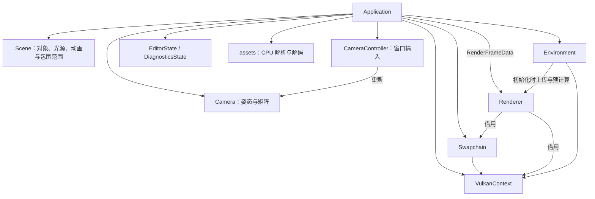

# VulkanProject

一个使用 C++17、Vulkan、GLFW 和 ImGui 编写的跨平台实时 PBR 渲染器。
项目最初运行于 Windows/MinGW，现在同时支持 x86_64 Linux 和 Apple Silicon
macOS；macOS 通过 MoltenVK 将 Vulkan 指令映射到 Metal。

## 当前能力

- 基于金属度/粗糙度工作流的 PBR 材质
- HDR 环境贴图、漫反射 irradiance 和预过滤 specular IBL
- Skybox、深度测试、MSAA 和多帧同步
- OBJ 模型导入，以及内置 Cube/Sphere 几何体
- 相机漫游、场景拾取、变换 gizmo 和点光源编辑
- ImGui 调试与场景控制界面
- 可切换的材质/阴影实验场景与 glTF 展示预设（[使用说明](docs/scene-presets.md)）
- Vulkan Memory Allocator（VMA）资源管理
- Vulkan Validation Layers 调试验证

## 开发路线

- [Phase 1：基础渲染器与资产管线](docs/todo-phase-1/overview.md)
- [Phase 2：现代 Vulkan、高级光栅与 ReSTIR](docs/todo-phase-2/overview.md)
- [Phase 2 · Stage 0 手敲指南：渲染基线与 GPU 计时](docs/todo-phase-2/stage-0-rendering-baseline.md)
- [Phase 2 · Stage 0.5 手敲指南：能力管理与 Vulkan 现代化](docs/todo-phase-2/stage-0-5-vulkan-modernization.md)
- [Phase 2 · Stage 1 手敲指南：四级 CSM](docs/todo-phase-2/stage-1-cascaded-shadow-maps.md)

## 技术栈

| 层级 | 组件 |
| --- | --- |
| 语言与构建 | C++17、CMake、Ninja |
| 包管理 | vcpkg manifest mode |
| 图形与窗口 | Vulkan、MoltenVK（macOS）、GLFW |
| 数学与 UI | GLM、Dear ImGui |
| 资源加载 | stb、TinyObjLoader |
| GPU 内存 | Vulkan Memory Allocator |
| 大文件 | Git LFS |

## 项目结构

```text
VulkanProject/
├── assets/
│   ├── models/          # OBJ 等可审查的模型源文件
│   ├── shaders/         # GLSL 源码和运行时 SPIR-V
│   └── textures/        # Git LFS 管理的纹理、HDR 和 skybox
├── cmake/
│   └── BuildConfig.hpp.in
├── docs/
│   ├── configuration.md
│   ├── diffuse-ibl.md
│   ├── standardization-log.md
│   └── todo-phase-1/
│       ├── overview.md
│       ├── stage-1-resource-lifetime.md
│       ├── stage-2-application-split.md
│       ├── stage-3-gpu-resource-layer.md
│       ├── stage-4-scene-mesh-material.md
│       └── stage-5-gltf-asset-pipeline.md
├── scripts/
│   ├── compile-shaders.bat
│   ├── compile-shaders.sh
│   └── run-macos.sh
├── src/
│   ├── app/             # Application 编排、输入与资产上传
│   ├── scene/           # Scene、Camera、光源与网格材质数据
│   ├── render/          # Renderer、Environment、设置与 shader ABI
│   ├── vulkan/          # Vulkan 上下文、交换链与 GPU 资源封装
│   ├── assets/          # glTF 解析和图片解码源码
│   ├── ui/              # 编辑器视图、交互状态与文件对话框
│   ├── diagnostics/     # 计时契约、诊断状态与基线采样
│   └── core/            # 应用配置、文件工具与延迟清理
├── CMakeLists.txt
├── CMakePresets.json
└── vcpkg.json
```

构建目录统一位于 `build/<preset>/`，不会提交到 Git。CMake 每次链接后会把
`assets/` 复制到当前构建目录，程序因此不依赖终端的当前工作目录。

## 源码目录

源码按职责分为八组，主要入口如下：

| 目录 | 职责与入口 |
| --- | --- |
| `src/app/` | [Application](src/app/Application.hpp) 编排窗口、帧流程、GPU 资产上传、descriptor 绑定与预设切换事务；[CameraController](src/app/CameraController.hpp) 处理窗口输入。 |
| `src/scene/` | [Scene](src/scene/Scene.hpp) 管理对象、光源、动画与包围范围；[Camera](src/scene/Camera.hpp) 提供相机数学；Mesh、Material、Vertex 和 Lighting 定义场景数据。 |
| `src/render/` | [Renderer](src/render/Renderer.hpp) 录制渲染 pass；[Environment](src/render/Environment.hpp) 管理环境图与 IBL；[RenderSettings](src/render/RenderSettings.hpp)、[ShaderTypes](src/render/ShaderTypes.hpp) 分别定义显示/阴影设置与 CPU/GLSL 布局。 |
| `src/vulkan/` | VulkanContext、Swapchain、GPU 资源 RAII、上传命令、检查与调试工具；[VulkanTypes](src/vulkan/VulkanTypes.hpp) 仅含队列族和交换链支持信息。 |
| `src/assets/` | GltfLoader、GltfImportTypes 和 ImageDecode，负责 CPU 资产解析与图片解码。 |
| `src/ui/` | [EditorUI.cpp](src/ui/EditorUI.cpp)、Diagnostics.cpp 和 FileDialog 展示应用视图；[EditorState](src/ui/EditorState.hpp) 保存选择、gizmo 与导入面板的临时状态。 |
| `src/diagnostics/` | [FrameTiming](src/diagnostics/FrameTiming.hpp) 定义 CPU/GPU 计时与绘制统计契约；[BaselineCapture](src/diagnostics/BaselineCapture.hpp) 处理基线采样；[DiagnosticsState](src/diagnostics/DiagnosticsState.hpp) 保存面板使用的快照、缓存和采集状态。 |
| `src/core/` | AppConfig、[FrameConfig](src/core/FrameConfig.hpp)、FileUtils 与 DeletionQueue 等公共配置和工具。 |

`Application` 持有窗口及各组件，安排初始化、逐帧更新、提交和退出。`Scene` 持有
对象与光源，统一更新动画和计算包围范围，物体矩阵由 `SceneObject::modelMatrix()`
生成。`Camera` 只处理姿态、view/projection 等数学；`CameraController` 处理 GLFW/ImGui
输入与光标控制。`EditorUI.cpp` 和 `Diagnostics.cpp` 仍实现 `Application` 的视图成员函数，
分别访问 `EditorState` 和 `DiagnosticsState`，没有新增独立的 Editor 对象。

`VulkanContext` 管理 instance、device、queues 和 VMA allocator；`Swapchain`
管理交换链及关联资源。`Renderer` 借用它们，管理飞行帧、渲染目标、管线、GPU query
和 Vulkan 命令录制。`Environment` 拥有 skybox、irradiance、prefilter、BRDF LUT 的四张
GPU 图像与四个 sampler，并管理预计算的临时资源；初始化完成后释放只用于预计算的
pass、pipeline 和 framebuffer。应用 descriptor 借用 Environment 提供的图像视图与 sampler。



应用仍负责 GPU 资产上传、资产缓存、材质 descriptor 发布、预设切换与失败回滚，
以及 UI 和渲染数据的绑定。`Scene` 中的 Mesh/Material 仍引用 GPU 资源句柄；Renderer
仍直接使用 Vulkan，并在 Present pass 中录制 ImGui。这次拆分保留这些实际边界，
没有引入多后端接口或把场景改成纯 CPU 数据模型。

项目源码头文件的 include 搜索根为 `src/`，不逐个添加子目录。include 使用模块前缀：

```cpp
#include "app/Application.hpp"
#include "scene/Scene.hpp"
#include "render/Renderer.hpp"
#include "render/ShaderTypes.hpp"
#include "assets/GltfLoader.hpp"
```

CMake 生成的 `BuildConfig.hpp` 位于 `build/<preset>/generated/`，该生成目录单独
作为 include 路径，继续写 `#include "BuildConfig.hpp"`。

`src/assets/` 存放资产处理的 C++ 源码；项目根的 `assets/` 存放模型、纹理、
GLSL 和 SPIR-V 等运行数据，并由构建步骤复制到 `build/<preset>/assets/`。

历史手敲教程保留当时的类名和代码路径。阅读当前主线时可按下表定位，避免重复添加
已经实现的类型或文件：

| 历史名称或位置 | 当前入口 |
| --- | --- |
| `TriangleApplication.*`、`InitVulkan()` | [app/Application.hpp](src/app/Application.hpp)、[Application.cpp](src/app/Application.cpp) 的 `initializeRendering()` |
| 应用成员中的相机数学和输入 | [scene/Camera.hpp](src/scene/Camera.hpp)、[app/CameraController.hpp](src/app/CameraController.hpp) |
| `app/IBL.cpp`、`app/Skybox.cpp` | [render/EnvironmentIBL.cpp](src/render/EnvironmentIBL.cpp)、[EnvironmentSkybox.cpp](src/render/EnvironmentSkybox.cpp)，由 [Environment.cpp](src/render/Environment.cpp) 初始化 |
| `ui/ImGuiLayer.cpp` | [ui/EditorUI.cpp](src/ui/EditorUI.cpp)；Diagnostics 视图位于 [ui/Diagnostics.cpp](src/ui/Diagnostics.cpp) |
| `GpuBaselineCapture`、`BaselineGpuSample` | [diagnostics/BaselineCapture.hpp](src/diagnostics/BaselineCapture.hpp) 中的 `BaselineCapture`、`BaselineSample` |
| `GpuTimingConfig` 与计时类型 | [diagnostics/FrameTiming.hpp](src/diagnostics/FrameTiming.hpp) 中的 `FrameTimingConfig` 等类型 |
| `VulkanTypes.hpp` 中的 Vertex、光源、UBO | [scene/Vertex.hpp](src/scene/Vertex.hpp)、[scene/Lighting.hpp](src/scene/Lighting.hpp)、[render/ShaderTypes.hpp](src/render/ShaderTypes.hpp)；Draw/Post push constants 也集中在 ShaderTypes 中 |
| `AppConfig.hpp` 中的飞行帧常量 | [core/FrameConfig.hpp](src/core/FrameConfig.hpp) |
| `ThirdPartyImplementations.cpp` | [vulkan/VmaImplementation.cpp](src/vulkan/VmaImplementation.cpp) 定义 VMA；[assets/ImageDecode.cpp](src/assets/ImageDecode.cpp) 定义 stb_image |

## 从零开始：Linux（Ubuntu/Debian x86_64）

以下命令以 Ubuntu 24.04 / Debian 系发行版为例。其他发行版需要安装名称相应的
C++ 工具链、Vulkan loader/driver、Validation Layers 和 X11 开发包。

### 1. 安装系统依赖

```sh
sudo apt update
sudo apt install -y \
  build-essential cmake ninja-build pkg-config git git-lfs curl zip unzip tar \
  libvulkan-dev vulkan-tools vulkan-validationlayers glslc \
  xorg-dev libglu1-mesa-dev
git lfs install
```

其中 X11 开发包用于 vcpkg 编译 GLFW，`glslc` 只在修改 GLSL shader 后需要。
项目在 Linux 上固定链接 `libvulkan-dev` 提供的系统 Vulkan loader，以匹配主机
显卡驱动；vcpkg 仍负责 GLFW、GLM、ImGui 等 C++ 依赖。还需要安装与显卡匹配的
Vulkan 驱动：

- Intel/AMD（Mesa）：通常安装 `mesa-vulkan-drivers`；
- NVIDIA：安装发行版推荐的专有驱动，避免混用不匹配版本的 Vulkan 库；
- 虚拟机、容器和 WSL：必须另外配置 GPU/Vulkan 转发，普通无 GPU 容器不能直接
  创建 Vulkan 窗口。

先确认 loader 能找到物理设备：

```sh
vulkaninfo --summary
```

输出中应能看到至少一个 `GPU`。若该命令失败，应先修复显卡驱动，再编译项目。

### 2. 从零安装 vcpkg

项目使用 vcpkg manifest mode；必须保留完整的 vcpkg 仓库：

```sh
git clone https://github.com/microsoft/vcpkg.git "$HOME/vcpkg"
"$HOME/vcpkg/bootstrap-vcpkg.sh" -disableMetrics
export VCPKG_ROOT="$HOME/vcpkg"
export PATH="$VCPKG_ROOT:$PATH"
```

如需永久生效，把最后两条 `export` 加入 `~/.bashrc`（使用其他 shell 时加入其
对应配置文件），然后重新打开终端。

### 3. Clone 项目与下载资源

```sh
git clone https://github.com/AirDryingFish/VulkanProject.git
cd VulkanProject
git lfs install
git lfs pull
```

确认 `git lfs pull` 成功完成，否则纹理仍是 LFS pointer，程序会在加载资源时失败。

### 4. 配置、编译与运行 Debug

```sh
cmake --preset linux-debug
cmake --build --preset linux-debug --parallel
./build/linux-debug/vulkan
```

首次配置会根据 `vcpkg.json` 为 `x64-linux` 编译依赖，耗时通常比后续增量构建长。
Debug 默认开启 Vulkan Validation Layers。

默认启动 Shadow Playground。在 Scene 标签的 Scene Presets 中可切换或重置场景，
也可使用 `./build/linux-debug/vulkan --scene metal-rough-spheres`。
`--list-scenes` 列出全部预设；当前已接入 Mask 与双面材质，Sponza 预设未禁用。
复杂场景的专项视觉/性能验收状态见 [场景说明](docs/scene-presets.md)。

### 5. Release 构建

```sh
cmake --preset linux-release
cmake --build --preset linux-release --parallel
./build/linux-release/vulkan
```

Release 默认关闭 Validation Layers。程序可从任意工作目录启动，因为资源路径在
配置时生成，构建后 `assets/` 会复制到相应的构建目录。

## 从零开始：macOS（Apple Silicon）

### 1. 安装系统工具和 Vulkan/MoltenVK

先安装 Xcode Command Line Tools：

```sh
xcode-select --install
```

通过 Homebrew 安装构建、资源和运行时工具：

```sh
brew install cmake ninja pkg-config git-lfs shaderc \
  molten-vk vulkan-loader vulkan-headers vulkan-validationlayers
git lfs install
```

`shaderc` 提供可选的 `glslc` shader 编译器。MoltenVK 是 macOS 实际使用的
Vulkan driver；`vulkan-loader` 负责加载它。

### 2. 从零安装 vcpkg

本项目需要完整的 vcpkg 仓库（可执行文件、ports 和 toolchain），不要只设置一个
孤立的 `vcpkg` 命令：

```sh
git clone https://github.com/microsoft/vcpkg.git "$HOME/vcpkg"
"$HOME/vcpkg/bootstrap-vcpkg.sh" -disableMetrics
export VCPKG_ROOT="$HOME/vcpkg"
export PATH="$VCPKG_ROOT:$PATH"
```

如需永久生效，把最后两条 `export` 加入 `~/.zshrc`，然后重新打开终端。

### 3. Clone 项目与下载资源

```sh
git clone https://github.com/AirDryingFish/VulkanProject.git
cd VulkanProject
git lfs install
git lfs pull
```

`git lfs pull` 必须完成；否则纹理文件只是很小的 LFS pointer，运行时无法加载。

### 4. 配置、编译与运行 Debug

```sh
cmake --preset macos-debug
cmake --build --preset macos-debug --parallel
./scripts/run-macos.sh
```

首次配置时 CMake 会读取 `vcpkg.json`，自动为 `arm64-osx` 构建全部 C++ 依赖。
启动脚本负责设置 MoltenVK driver 和 Validation Layer 的 Homebrew 路径。

### 5. Release 构建

```sh
cmake --preset macos-release
cmake --build --preset macos-release --parallel
./scripts/run-macos.sh macos-release
```

## 从零开始：Windows（MinGW x64）

### 1. 安装工具

安装并加入 `PATH`：

- Git for Windows（包含 Git LFS）
- CMake 3.20+
- Ninja
- MinGW-w64 的 `g++`
- LunarG Vulkan SDK（包含 Vulkan runtime、Validation Layers 和 `glslc`）

在新的 PowerShell 中验证：

```powershell
git --version
git lfs version
cmake --version
ninja --version
g++ --version
glslc --version
```

### 2. 从零安装 vcpkg

```powershell
git clone https://github.com/microsoft/vcpkg.git C:\dev\vcpkg
C:\dev\vcpkg\bootstrap-vcpkg.bat -disableMetrics
$env:VCPKG_ROOT = "C:\dev\vcpkg"
$env:Path = "$env:VCPKG_ROOT;$env:Path"
```

如需永久设置，可运行 `setx VCPKG_ROOT C:\dev\vcpkg`，之后重新打开终端。

### 3. Clone、配置、编译与运行

```powershell
git clone https://github.com/AirDryingFish/VulkanProject.git
cd VulkanProject
git lfs install
git lfs pull

cmake --preset windows-mingw-debug
cmake --build --preset windows-mingw-debug --parallel
.\build\windows-mingw-debug\vulkan.exe
```

Release：

```powershell
cmake --preset windows-mingw-release
cmake --build --preset windows-mingw-release --parallel
.\build\windows-mingw-release\vulkan.exe
```

MinGW 必须与 `x64-mingw-dynamic` triplet 匹配，且 `g++` 应当在 `PATH` 中，preset
不再保存任何个人电脑的绝对编译器路径。

## Shader 开发

仓库保留 GLSL 源码和程序直接加载的 SPIR-V。修改 shader 后重新生成 SPIR-V：

Linux / macOS：

```sh
./scripts/compile-shaders.sh
```

Windows：

```powershell
.\scripts\compile-shaders.bat
```

重新编译项目会把更新后的 shader 复制到构建目录。

## 资源管理约定

- 模型放在 `assets/models/`。OBJ 是文本格式，继续使用普通 Git，便于 diff。
- 纹理、HDR、DDS、KTX 放在 `assets/textures/`，由 `.gitattributes` 自动交给
  Git LFS；新增资源后用 `git lfs ls-files` 确认。
- GLSL 和 SPIR-V 放在 `assets/shaders/`，编译脚本不放入资源目录。
- 源码只通过 `src/core/AppConfig.hpp` 中的命名路径访问内置资源，不新增 `../assets`、
  `../textures` 等相对路径。
- 外部 OBJ 导入仍允许用户在 ImGui 中输入任意路径。
- 当前材质没有 AO 图片时会使用白色 fallback，不会阻止程序启动。

## 构建配置与宏约定

- 平台、验证层、版本号和构建资源根由 CMake 生成到 `BuildConfig.hpp`。
- Debug preset 默认开启 Validation Layers，Release 默认关闭。
- GLM 宏是 target 级 compile definitions。
- `VMA_IMPLEMENTATION` 集中在 `src/vulkan/VmaImplementation.cpp`；
  `STB_IMAGE_IMPLEMENTATION` 集中在 `src/assets/ImageDecode.cpp`，各自只定义一次。
- 不在业务源码里直接新增 `_WIN32`、`__APPLE__` 或 `NDEBUG` 判断。

完整规则参见 `docs/configuration.md`。

## 常见问题

### CMake 找不到 vcpkg toolchain

确认当前终端存在：

```sh
echo "$VCPKG_ROOT"
test -f "$VCPKG_ROOT/scripts/buildsystems/vcpkg.cmake"
```

Windows PowerShell 对应检查：

```powershell
echo $env:VCPKG_ROOT
Test-Path "$env:VCPKG_ROOT\scripts\buildsystems\vcpkg.cmake"
```

### Linux 下 `vulkaninfo` 找不到设备或程序报 `failed to find GPUs`

这通常是显卡 Vulkan 驱动问题，而非 vcpkg 依赖问题。先运行
`vulkaninfo --summary`；Intel/AMD 检查 `mesa-vulkan-drivers`，NVIDIA 检查当前
内核模块与用户态驱动版本是否一致。多 GPU 机器还可用
`VK_LOADER_DEBUG=error,warn,driver vulkaninfo --summary` 检查实际加载的 ICD。

### Linux 配置时 GLFW 报缺少 X11 库

安装 `xorg-dev libglu1-mesa-dev pkg-config` 后，删除失败的 Linux 构建目录并重新
执行 preset：

```sh
rm -rf build/linux-debug
cmake --preset linux-debug
```

### macOS 报 `failed to find GPUs with Vulkan support`

不要直接跳过 `scripts/run-macos.sh`。它会设置 `VK_DRIVER_FILES`，使 Vulkan loader
找到 Homebrew 安装的 MoltenVK ICD。

### Validation Layer 无法加载

确认已安装 `vulkan-validationlayers`，并通过启动脚本运行 Debug 版本。Release
版本不要求 Validation Layer。

### 模型或纹理加载失败

先执行 `git lfs pull`，再重新构建以刷新 `build/<preset>/assets/`。检查目标资源
是否真实存在，而不是 LFS pointer 文本。

## 变更学习记录

规范化类改动必须同步追加到 `docs/standardization-log.md`，每条至少说明：

1. 原问题；
2. 做了什么；
3. 为什么这样选择；
4. 如何验证。

这样后续 review 不只看到代码差异，也能理解项目约定的形成原因。
